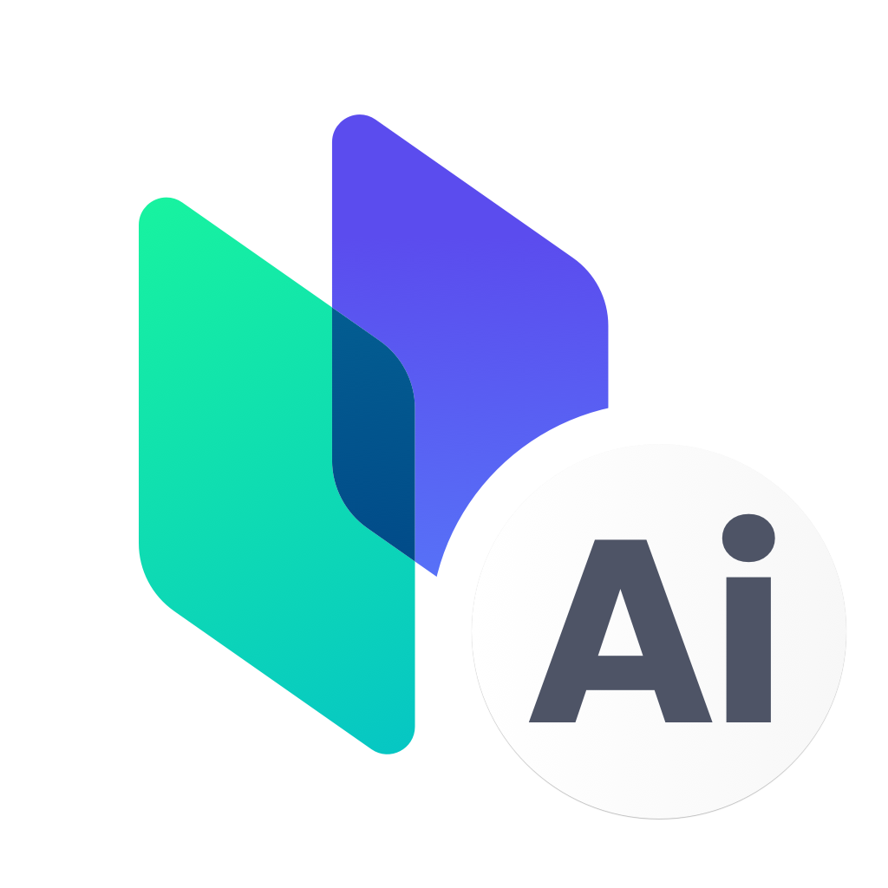
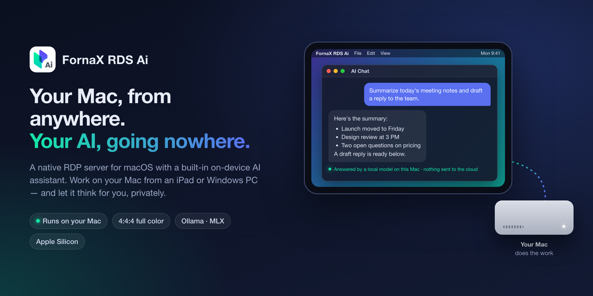
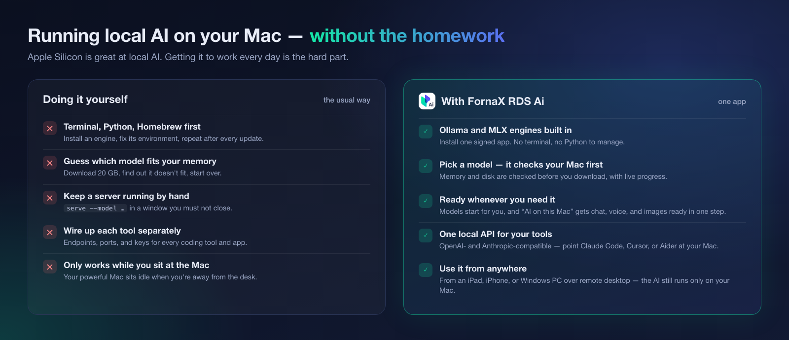
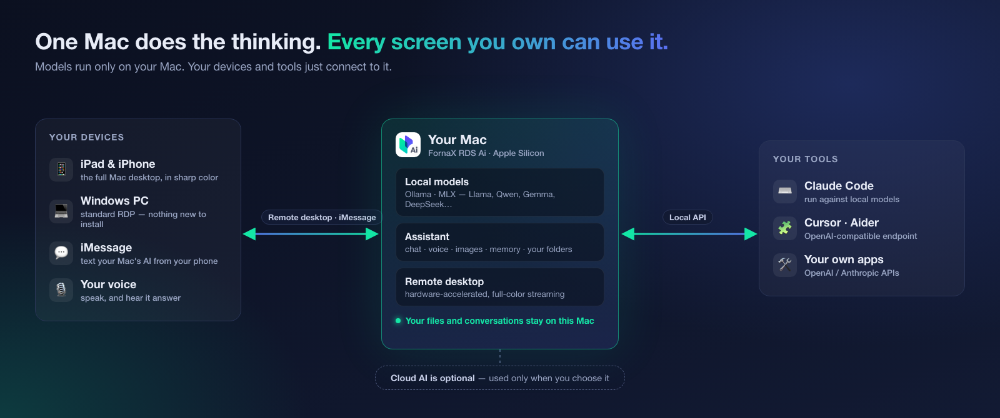

# FornaX RDS Ai

[English](README.md) · [한국어](README.ko.md) · **日本語**

### Mac でローカル AI を数分で。そして手元のどの画面からでも。

**Mac はどこからでも。AI は Mac の中だけで。**

*Mac Studio を再起動して席を離れても、iPad からそのままログインできます。 画像づくり・要約・コーディングを頼んでも、処理はすべて Mac の中。クラウドには送りません。*

 

---

> **⬇️ 無料で始められます。** FornaX RDS Ai は署名・公証済みの Mac アプリです。[**製品ページ**](https://www.gloovir.com/products/fornax-rds-ai)で下のプロモーションキーを入力すると、すぐにダウンロードリンクが届きます。
>
> **プロモーションキー:** `FornaXRDS-Ai_20260708`
>
> ⭐ **このリポジトリに Star** を付けて最新情報を受け取ってください。ソースコードは公開せず、署名済みアプリとして配布しています。

## Mac でローカル AI を使いたいなら、面倒な準備は不要です。

Apple Silicon の Mac は、AI モデルをローカルで動かすのにとても向いています。会話は外に出ず、オフラインでも動き、トークン課金もありません。難しいのはモデルの周りの作業です。エンジンの導入、Python 環境、メモリに収まるモデル選び、サーバーの常時起動、ツールごとの接続設定。

FornaX RDS Ai はこれらをひとつのアプリで解決します。**モデルを選べば数分で使え**、iPad・iPhone・Windows PC からも続けて使えます。

## できること

**設定いらずのローカル AI**
- **Ollama と MLX エンジンを内蔵**: Llama、Qwen、Gemma、DeepSeek、Mistral、Phi などを Mac で実行
- **モデルマネージャー**: ダウンロード前にメモリとストレージを確認し、進行状況を表示
- **「この Mac の AI」**: チャット・音声・画像のモデルをまとめて準備
- **ひとつのローカル API**: OpenAI・Anthropic 互換なので、Claude Code、Cursor、Aider が Mac のモデルを使えます

**仕事を任せられるアシスタント**
- チャット、**音声**(話して聞く会話)、Mac の中での**画像・音楽・動画の生成**
- 頼んだことを**記憶**し、**自分のフォルダ**やナレッジベースの文書から回答
- **リモートデスクトップ、iMessage、コマンドライン**から呼び出し可能
- クラウド AI(31 社以上)は**任意**で、タスクごとに選べます

**本格的な Mac リモートデスクトップ**
- **macOS 向けネイティブ RDP サーバー**: Windows、iPad、iPhone、ほかの Mac から標準クライアント(Windows App / Microsoft Remote Desktop)で接続
- **再起動直後もリモートログイン**: Mac の前に誰もいなくても大丈夫
- Apple Silicon のハードウェアアクセラレーション、マルチモニター、音声、ファイル・クリップボード共有
- AVC444 対応クライアントで **4:4:4 フルカラー**

> **4:4:4 が大切な理由:** 多くのリモートデスクトップは色情報を 4 分の 1 の解像度(4:2:0)で送るため、色付きの文字や細い線がにじみます。AVC444 対応クライアントでは FornaX RDS Ai がすべてのピクセルの色を送るので、コード・グラフ・デザイン作業がくっきり見えます。

アプリは**日本語、英語、韓国語**に対応しています。アップデートや削除のときに**データを残す**こともできます(キー、会話、記憶、ナレッジベース)。

## ✨ 最近追加された機能

- 🔑 **再起動直後にリモートログイン**: アップデートや停電のあとも、ログイン画面からそのまま接続できます。
- 🎨 **Mac の中で画像・音楽・動画を生成**: モデルを一度ダウンロードすれば、会話中に作成・編集できます。
- 🧠 **忘れないアシスタント**: 覚えてと頼んだ内容は会話をまたいで残り、*あなたが消したときだけ*消えます。
- 🚀 **「この Mac の AI」**: チャット・音声・画像のモデルをまとめて準備します。
- 📂 **自分のフォルダの文書から回答**: フォルダを選ぶと、その中の文書を Mac の中で探して答えます。
- 📱 **iPad でよりなめらかに**: 画面の更新が速くなり、入力の反応がよくなり、動画が止まって見えなくなりました。

## プラン

| | Free | Pro | Enterprise |
|---|---|---|---|
| 対象 | 自分の Mac で試す | 個人・チーム | 大規模導入 |
| Mac の台数 | 1 | 1 | 無制限 |
| ローカル AI | ✅ | ✅ | ✅ |
| リモート音声 | — | ✅ | ✅ |
| 商用利用 | — | ✅ | ✅ |
| サポート | コミュニティ | メール | 優先サポート・高可用性・カスタム機能 |

最新の価格は[**製品ページ**](https://www.gloovir.com/products/fornax-rds-ai)をご覧ください。

## ほかの製品との比較

| | Mac **RDP サーバー** | 4:4:4 フルカラー | 内蔵**ローカル AI アシスタント** |
|---|:---:|:---:|:---:|
| **FornaX RDS Ai** | ✅ | ✅ AVC444/v2 | ✅ |
| xrdp(オープンソース) | Linux 向け、macOS 版は非公式 | — | — |
| RustDesk / Sunshine | 独自プロトコル(RDP ではない) | — | — |
| Apple の画面共有 | Mac 同士のみ | — | — |
| Windows RDP | Windows 専用 | ✅ | — |

リモートデスクトップとデバイス内 AI アシスタントをひとつのアプリにまとめた製品は見つかりませんでした。ご存じでしたら [Discussions](../../discussions) で教えてください。

## チーム・企業向け

- **データは既定で外に出ません**: AI は各ユーザーの Mac で動くため、許可しない限り社内のコードや文書がクラウド AI に送られることはありません
- **ローカルモデルならユーザーごとの AI サブスクリプションは不要**
- MDM 配布向けの**署名・公証済み PKG**、権限を確認する自動化
- クラウド AI の利用が制限される分野に適しています: 金融、法務、医療、公共、研究開発

## 信頼と誠実さ

- **ソースは公開していません。そのぶん信頼が必要なことを理解しています。** アプリには画面・入力・(任意で)iMessage の権限が必要です。すべてのバージョンは **Developer ID で署名・公証**しており、ローカルモデルを使えば会話とファイルは Mac の中に残ります。
- アプリが何をどこへ送るかを確認できる**ネットワーク動作の透明性ドキュメントを準備中**です。
- **macOS は速く変わります。** macOS のベータを追いかけ、互換アップデートを出しています。
- **新しい製品です。** [Issues](../../issues) と [Discussions](../../discussions) のご意見が次に作るものを決めます。

## よくある質問

**ターミナルを使わずに Mac でローカル LLM を動かすには?**
FornaX RDS Ai をインストールし、モデルマネージャーでモデルを選ぶだけです。Ollama と MLX を内蔵しており、ダウンロード前にメモリとストレージを確認してからモデルを起動します。

**ローカル AI にはどの Mac が必要ですか?**
macOS 13 Ventura 以降の Apple Silicon Mac(M1 以降)です。ユニファイドメモリが大きいほど大きなモデルを動かせ、ダウンロード前にお使いの Mac に収まるかを表示します。

**Claude Code、Cursor、Aider を Mac のローカルモデルで使えますか?**
はい。OpenAI・Anthropic 互換のローカルエンドポイントを提供しています。

**macOS 用の RDP サーバーはありますか?**
はい。FornaX RDS Ai は macOS 向けのネイティブ RDP サーバーです。Windows、iPad、iPhone、ほかの Mac から Windows App(Microsoft Remote Desktop)などの標準クライアントで接続できます。

**iPad や Windows PC から Mac にリモート接続するには?**
Mac に FornaX RDS Ai をインストールし、iPad や PC の Windows App / リモートデスクトップアプリにその Mac を追加します。

**Mac を再起動したあと、Mac の前でログインしなくても接続できますか?**
はい。アップデートや停電のあとも、ログイン画面からそのまま接続できます。

**無料ですか?**
Mac 1 台でローカル AI を含めて無料で始められます。Pro はリモート音声、商用利用、メールサポートを追加し、Enterprise は大規模導入向けです。[製品ページ](https://www.gloovir.com/products/fornax-rds-ai)をご覧ください。

**データは Mac の外に出ますか?**
ローカルモデルを使う場合は出ません。クラウド AI は任意で、選んだときだけ使われます。

## 動作環境

- macOS 13(Ventura)以降
- **Apple Silicon Mac 専用**(Intel Mac は非対応)

## ロードマップ

- [x] 署名・公証済みの一般公開
- [ ] ドキュメントとクイックスタートガイド
- [ ] ネットワーク動作・プライバシーの透明性ドキュメント
- [ ] 毎月の新しい AI モデルと機能
- [ ] ユーザーの声を反映した継続的なアップデート

## ライセンスと連絡先

FornaX RDS Ai は**バイナリで配布する商用ソフトウェア**です。ライセンス条件(EULA)はアプリに同梱されています。
Web サイト: [gloovir.com](https://gloovir.com) · お問い合わせ: contact@gloovir.com

---

© GlooVir Inc. All rights reserved. FornaX, FornaX RDS Ai are trademarks of GlooVir.

