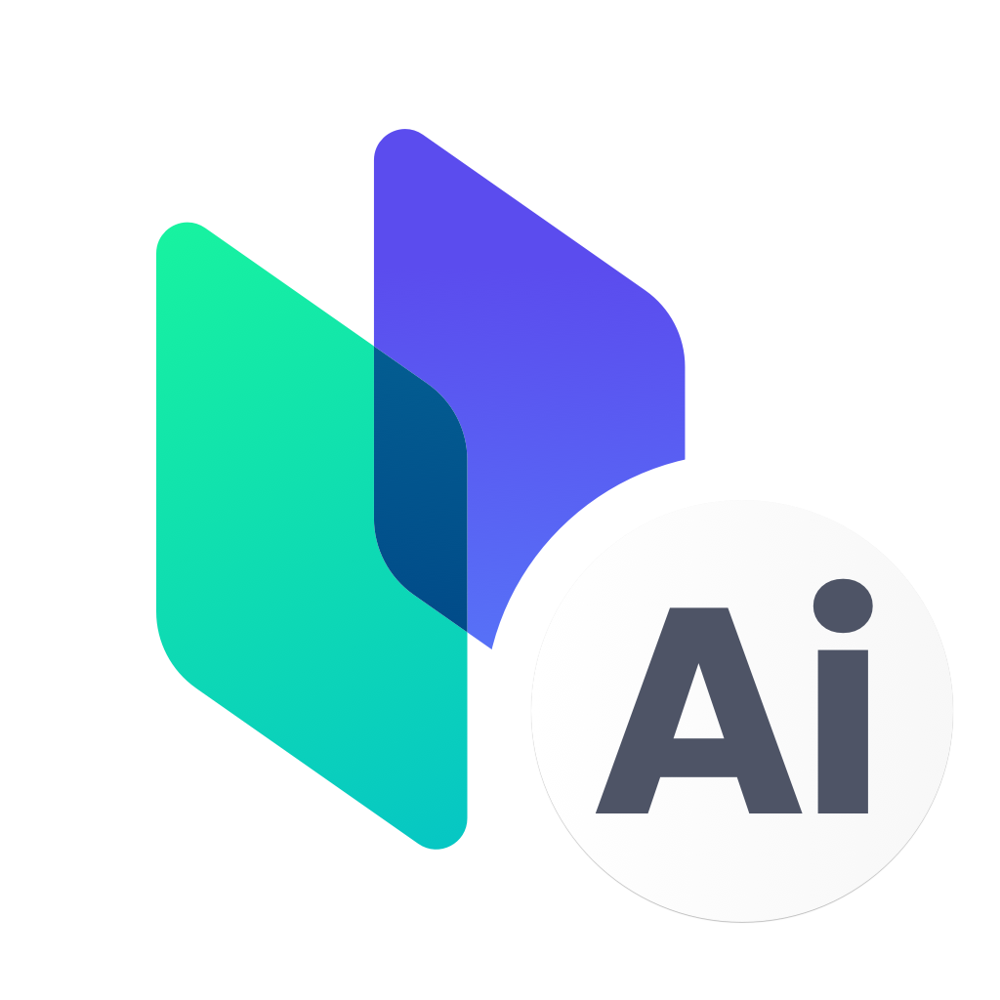
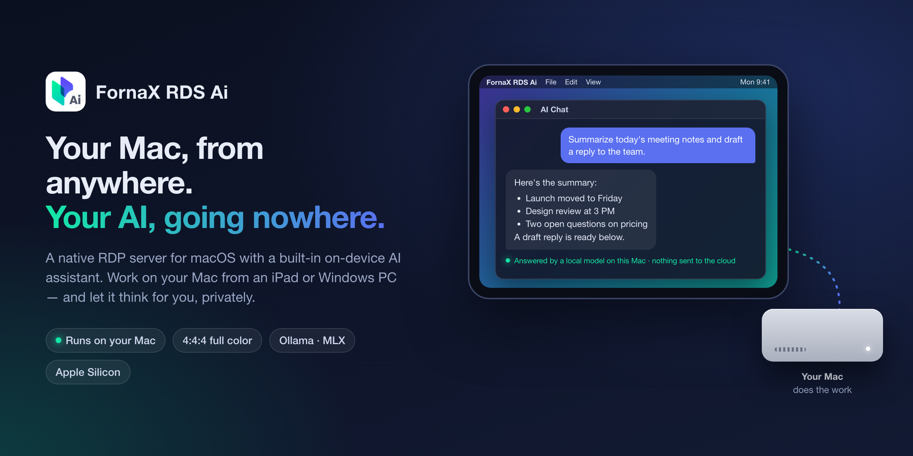
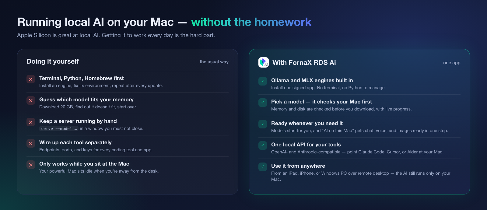
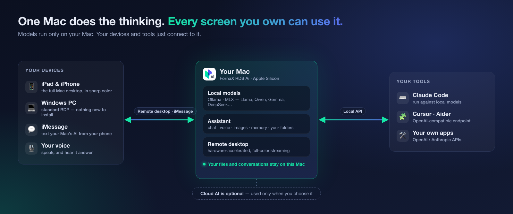

# FornaX RDS Ai

[English](README.md) · **한국어** · [日本語](README.ja.md)

### 내 Mac에서 로컬 AI를 몇 분 만에, 그리고 내가 가진 어떤 화면에서든.

**Mac은 어디서나, AI는 Mac 안에서만.**

*Mac Studio를 재시작하고 자리를 떠나도, iPad에서 바로 로그인할 수 있습니다. 그림·요약·코딩을 맡겨도 모든 처리는 Mac 안에서, 클라우드로 보내지 않습니다.*

 

---

> **⬇️ 무료로 시작하세요.** FornaX RDS Ai는 서명·공증된 Mac 앱입니다. [**제품 페이지**](https://www.gloovir.com/products/fornax-rds-ai)에서 아래 프로모션 키를 입력하면 바로 다운로드 링크를 받을 수 있습니다.
>
> **프로모션 키:** `FornaXRDS-Ai_20260708`
>
> ⭐ **이 저장소에 Star**를 눌러 소식을 받아 보세요. 소스 코드는 공개하지 않으며, 서명된 앱으로 배포합니다.

## 내 Mac에서 로컬 AI를 쓰고 싶다면, 번거로운 준비는 건너뛰세요.

Apple Silicon Mac은 AI 모델을 로컬에서 돌리기에 아주 좋습니다. 대화가 밖으로 나가지 않고, 인터넷 없이도 되고, 토큰 요금도 없습니다. 어려운 건 모델 주변의 일입니다. 엔진 설치, Python 환경, 메모리에 맞는 모델 고르기, 서버를 계속 띄워 두기, 도구마다 연결하기.

FornaX RDS Ai는 이 모든 것을 앱 하나로 해결합니다. **모델을 고르면 몇 분 안에 쓸 수 있고**, iPad·iPhone·Windows PC에서도 그대로 이어서 씁니다.

## 무엇을 할 수 있나요

**설정 없이 쓰는 로컬 AI**
- **Ollama와 MLX 엔진 내장**: Llama, Qwen, Gemma, DeepSeek, Mistral, Phi 등을 Mac에서 실행
- **모델 관리자**: 받기 전에 메모리와 저장 공간을 먼저 확인하고, 진행 상황을 보여 줍니다
- **«이 Mac의 AI»**: 채팅·음성·이미지 모델을 한 번에 준비
- **하나의 로컬 API**: OpenAI·Anthropic 호환이라 Claude Code, Cursor, Aider가 내 Mac의 모델을 씁니다

**일을 맡길 수 있는 비서**
- 채팅, **음성**(말하고 들으며 대화), Mac 안에서 **이미지·음악·영상 만들기**
- 부탁한 내용을 **기억**하고, **내 폴더**와 지식 베이스의 문서로 답합니다
- **원격 데스크톱, iMessage, 명령줄**에서 부를 수 있습니다
- 클라우드 AI(31곳 이상)는 **선택 사항**이며, 작업마다 고를 수 있습니다

**제대로 된 Mac 원격 데스크톱**
- **macOS용 네이티브 RDP 서버**: Windows, iPad, iPhone, 다른 Mac에서 표준 클라이언트(Windows App / Microsoft Remote Desktop)로 접속
- **재시작 직후에도 원격 로그인**: Mac 앞에 아무도 없어도 됩니다
- Apple Silicon 하드웨어 가속 전송, 멀티 모니터, 소리, 파일·클립보드 공유
- AVC444를 지원하는 클라이언트에서 **4:4:4 풀컬러**

> **4:4:4가 중요한 이유:** 대부분의 원격 데스크톱은 색 정보를 4분의 1 해상도(4:2:0)로 보내서, 색이 있는 글자와 얇은 선이 번집니다. AVC444를 지원하는 클라이언트에서는 FornaX RDS Ai가 모든 픽셀의 색을 보내, 코드·차트·디자인 작업이 선명하게 보입니다.

앱은 **한국어, 영어, 일본어**를 지원합니다. 업데이트하거나 삭제할 때 **데이터를 남길 수 있습니다**(키, 대화, 기억, 지식 베이스).

## ✨ 최근 추가된 기능

- 🔑 **재시작 직후 바로 원격 로그인**: 업데이트나 정전 뒤에도 로그인 화면부터 바로 접속합니다.
- 🎨 **Mac 안에서 이미지·음악·영상 만들기**: 모델을 한 번 받으면 대화 중에 만들고 고칠 수 있습니다.
- 🧠 **잊지 않는 비서**: 기억해 달라고 한 내용은 대화가 바뀌어도 남고, *사용자가 지울 때만* 사라집니다.
- 🚀 **«이 Mac의 AI»**: 채팅·음성·이미지 모델을 한 번에 준비합니다.
- 📂 **내 폴더 문서로 답하기**: 폴더를 고르면 그 안의 문서를 Mac 안에서 찾아 답합니다.
- 📱 **iPad에서 더 매끄럽게**: 화면이 더 빨리 바뀌고, 입력 반응이 좋아졌고, 영상이 멈춘 것처럼 보이지 않습니다.

## 요금제

| | Free | Pro | Enterprise |
|---|---|---|---|
| 대상 | 내 Mac에서 써 보기 | 개인과 팀 | 대규모 도입 |
| Mac 대수 | 1 | 1 | 제한 없음 |
| 로컬 AI | ✅ | ✅ | ✅ |
| 원격 소리 | — | ✅ | ✅ |
| 상업적 사용 | — | ✅ | ✅ |
| 지원 | 커뮤니티 | 이메일 | 우선 지원 · 고가용성 · 맞춤 기능 |

현재 가격은 [**제품 페이지**](https://www.gloovir.com/products/fornax-rds-ai)에서 확인하세요.

## 다른 제품과 비교

| | Mac **RDP 서버** | 4:4:4 풀컬러 | 내장 **로컬 AI 비서** |
|---|:---:|:---:|:---:|
| **FornaX RDS Ai** | ✅ | ✅ AVC444/v2 | ✅ |
| xrdp (오픈소스) | Linux용, macOS 판은 비공식 | — | — |
| RustDesk / Sunshine | 자체 프로토콜(RDP 아님) | — | — |
| Apple 화면 공유 | Mac끼리만 | — | — |
| Windows RDP | Windows 전용 | ✅ | — |

원격 데스크톱과 기기 내 AI 비서를 한 앱에 담은 제품은 찾지 못했습니다. 알고 계신 제품이 있다면 [Discussions](../../discussions)에 알려 주세요.

## 팀과 기업을 위해

- **기본적으로 데이터가 밖으로 나가지 않음**: AI가 각 사용자의 Mac에서 돌기 때문에, 허용하지 않는 한 사내 코드와 문서가 클라우드 AI로 가지 않습니다
- **로컬 모델은 사용자별 AI 구독료가 없습니다**
- MDM 배포용 **서명·공증 PKG**, 권한을 확인하는 자동화
- 클라우드 AI 사용이 제한된 곳에 적합: 금융, 법률, 의료, 공공, 연구개발

## 신뢰와 솔직함

- **소스를 공개하지 않습니다. 그만큼 신뢰가 필요하다는 것을 압니다.** 앱은 화면·입력·(선택적으로) iMessage 권한이 필요합니다. 모든 버전은 **Developer ID로 서명·공증**하며, 로컬 모델을 쓰면 대화와 파일은 Mac 안에 남습니다.
- 앱이 무엇을 어디로 보내는지 확인할 수 있는 **네트워크 동작 투명성 문서를 준비 중**입니다.
- **macOS는 빠르게 바뀝니다.** macOS 베타를 따라가며 호환 업데이트를 냅니다.
- **새 제품입니다.** [Issues](../../issues)와 [Discussions](../../discussions)의 의견이 다음에 만들 것을 정합니다.

## 자주 묻는 질문

**터미널 없이 Mac에서 로컬 LLM을 돌리려면?**
FornaX RDS Ai를 설치하고 모델 관리자에서 모델을 고르면 됩니다. Ollama와 MLX가 내장되어 있고, 받기 전에 메모리와 저장 공간을 확인한 뒤 모델을 실행해 줍니다.

**로컬 AI에는 어떤 Mac이 필요한가요?**
macOS 13 Ventura 이상의 Apple Silicon Mac(M1 이상)이면 됩니다. 통합 메모리가 클수록 큰 모델을 돌릴 수 있고, 받기 전에 내 Mac에 맞는지 보여 줍니다.

**Claude Code, Cursor, Aider를 내 Mac의 로컬 모델로 쓸 수 있나요?**
네. OpenAI·Anthropic 호환 로컬 주소를 제공합니다.

**macOS용 RDP 서버가 있나요?**
네. FornaX RDS Ai가 macOS용 네이티브 RDP 서버입니다. Windows, iPad, iPhone, 다른 Mac에서 Windows App(Microsoft Remote Desktop) 같은 표준 클라이언트로 접속합니다.

**iPad나 Windows PC에서 Mac에 원격 접속하려면?**
Mac에 FornaX RDS Ai를 설치하고, iPad나 PC의 Windows App / 원격 데스크톱 앱에 그 Mac을 추가하면 됩니다.

**Mac을 재시작한 뒤, Mac 앞에서 로그인하지 않고도 접속되나요?**
네. 업데이트나 정전 뒤에도 로그인 화면부터 바로 접속할 수 있습니다.

**무료인가요?**
Mac 1대에서 로컬 AI를 포함해 무료로 시작할 수 있습니다. Pro는 원격 소리, 상업적 사용, 이메일 지원을 더하고, Enterprise는 대규모 도입용입니다. [제품 페이지](https://www.gloovir.com/products/fornax-rds-ai)를 참고하세요.

**내 데이터가 Mac 밖으로 나가나요?**
로컬 모델을 쓰면 나가지 않습니다. 클라우드 AI는 선택 사항이며, 고를 때만 씁니다.

## 요구 사항

- macOS 13 (Ventura) 이상
- **Apple Silicon Mac 전용** (Intel Mac은 지원하지 않음)

## 로드맵

- [x] 서명·공증된 공개 배포
- [ ] 문서와 빠른 시작 안내
- [ ] 네트워크 동작·개인정보 투명성 문서
- [ ] 매달 새 AI 모델과 기능
- [ ] 사용자 의견을 반영한 꾸준한 업데이트

## 라이선스와 연락처

FornaX RDS Ai는 **바이너리로 배포하는 상용 소프트웨어**이며, 라이선스 조건(EULA)은 앱에 포함되어 있습니다.
웹사이트: [gloovir.com](https://gloovir.com) · 문의: contact@gloovir.com

---

© GlooVir Inc. All rights reserved. FornaX, FornaX RDS Ai are trademarks of GlooVir.

