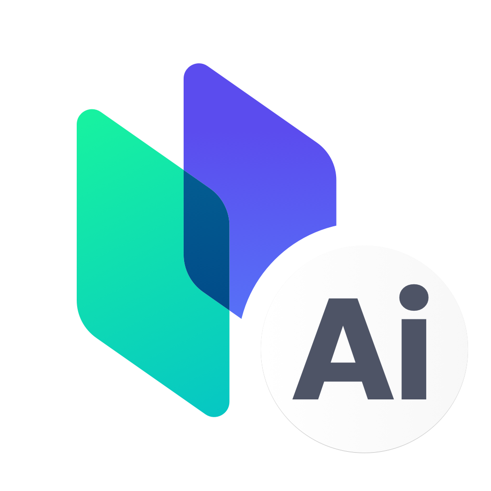
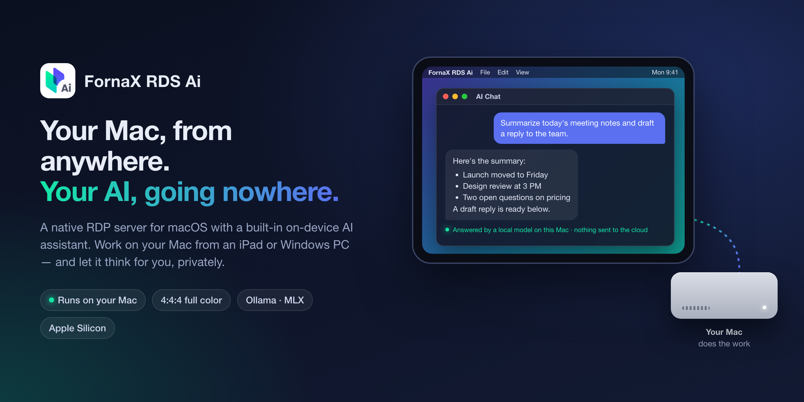
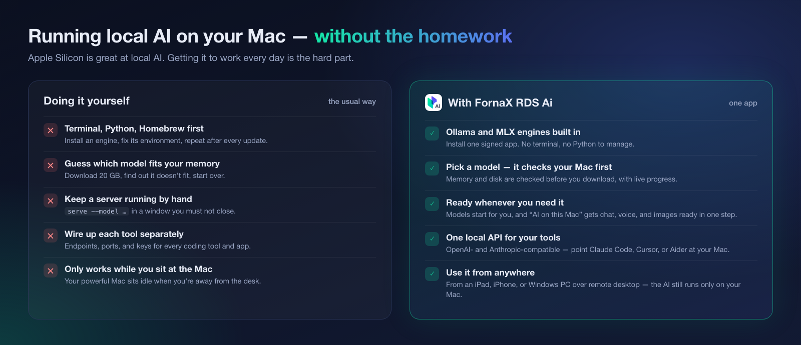
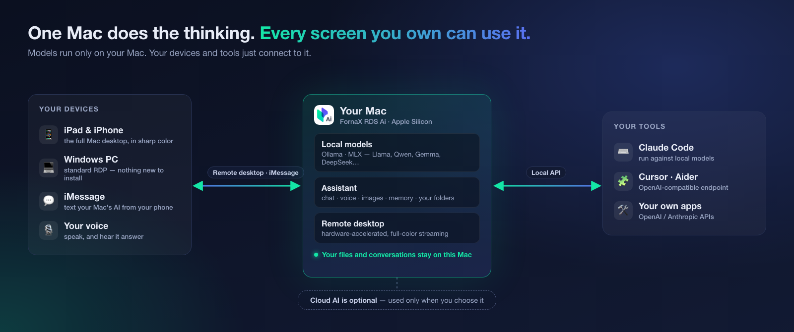

# FornaX RDS Ai

**English** · [한국어](README.ko.md) · [日本語](README.ja.md)

### Local AI on your Mac, ready in minutes — and usable from any screen you own.

**Your Mac, from anywhere. Your AI, going nowhere.**

*Restart your Mac Studio, walk away, and log in to it from your iPad — no one at the desk. Then ask it to draw, summarize, or code — all on the Mac, nothing sent to the cloud.*

 

---

> **⬇️ Free to start.** FornaX RDS Ai is a signed & notarized Mac app. Open the [**product page**](https://www.gloovir.com/products/fornax-rds-ai), enter the promotion key below, and you'll get a download link right away.
>
> **Promotion key:** `FornaXRDS-Ai_20260708`
>
> ⭐ **Star this repo** to follow FornaX RDS Ai. Source code is not published; the app is distributed as a signed binary.

## Want local AI on your Mac? Skip the homework.

Apple Silicon Macs are excellent at running AI models locally — private, offline, and with no per-token bill. The hard part is everything around the model: engines, Python environments, guessing what fits in memory, keeping a server alive, and wiring each tool to it.

FornaX RDS Ai does all of that in one app. **Pick a model and start using it in minutes** — then reach it from your iPad, iPhone, or Windows PC.

## What you get

**Local AI, without the setup**
- **Ollama and MLX engines built in** — run Llama, Qwen, Gemma, DeepSeek, Mistral, Phi and more on your Mac
- **Model manager** that checks memory and disk before you download, with live progress
- **"AI on this Mac"** — chat, voice, and image models ready in one step
- **One local API** — OpenAI- and Anthropic-compatible, so Claude Code, Cursor, and Aider can use your Mac's models

**An assistant that works for you**
- Chat, **voice** (speak and hear replies), and **image, music, and video creation** — on the Mac
- **Remembers** what you ask it to, and answers from **your own folders** and knowledge base
- Reach it over **remote desktop, iMessage, or the command line**
- Cloud AI (31+ providers) is **optional**, chosen per task

**A real remote desktop for your Mac**
- Native **RDP server for macOS** — connect with standard clients (Windows App / Microsoft Remote Desktop) from Windows, iPad, iPhone, or another Mac
- **Log in remotely right after a restart** — no one needs to sit at the Mac first
- Hardware-accelerated streaming on Apple Silicon, multi-monitor, audio, file and clipboard sharing
- **4:4:4 full color** with AVC444-capable clients

> **Why 4:4:4 matters:** most remote desktops send color at a quarter of the resolution (4:2:0), which blurs colored text and thin UI lines. With an AVC444-capable client, FornaX RDS Ai sends full color for every pixel, so code, charts, and design work stay crisp.

The app is available in **Korean, English, and Japanese**. On update or uninstall, you can **keep your data** (keys, conversations, memory, knowledge base).

## ✨ Recently added

- 🔑 **Log in remotely right after a restart** — after an update or a power outage, connect straight from the login window.
- 🎨 **Create images, music, and video on your Mac** — download a model once, then generate and edit media during a chat.
- 🧠 **An assistant that doesn't forget** — what you ask it to remember is kept across conversations; it only forgets when *you* delete it.
- 🚀 **"AI on this Mac"** — get chat, voice, and image models ready in one step.
- 📂 **Answers from your own folders** — pick folders and the assistant searches the documents in them on your Mac.
- 📱 **Smoother from an iPad** — faster screen updates, more responsive typing, and video that keeps playing.

## Plans

| | Free | Pro | Enterprise |
|---|---|---|---|
| For | Trying it on your own Mac | Individuals and teams | Large deployments |
| Macs | 1 | 1 | Unlimited |
| Local AI | ✅ | ✅ | ✅ |
| Remote audio | — | ✅ | ✅ |
| Commercial use | — | ✅ | ✅ |
| Support | Community | Email | Priority · high availability · custom features |

See current pricing on the [**product page**](https://www.gloovir.com/products/fornax-rds-ai).

## How it compares

| | Mac **RDP server** | 4:4:4 full color | Built-in **local AI assistant** |
|---|:---:|:---:|:---:|
| **FornaX RDS Ai** | ✅ | ✅ AVC444/v2 | ✅ |
| xrdp (open source) | Linux; macOS port is unofficial | — | — |
| RustDesk / Sunshine | own protocols, not RDP | — | — |
| Apple Screen Sharing | Mac-to-Mac only | — | — |
| Windows RDP | Windows only | ✅ | — |

We couldn't find another product that puts a remote desktop and an on-device AI assistant in one app. If you know one, tell us in [Discussions](../../discussions).

## For teams and enterprise

- **No data egress by default** — AI runs on each user's Mac; internal code and documents are not sent to cloud AI unless you allow it
- **No per-seat AI subscription** for local models
- **Signed and notarized PKG** for MDM distribution, with permission-gated automation
- A fit where cloud AI is restricted — finance, legal, healthcare, public sector, R&D

## Trust and honesty

- **Closed source, and we know that asks for trust.** The app needs screen, input, and (optionally) iMessage permissions. Every release is **Developer ID–signed and notarized**, and with local models your conversations and files stay on your Mac.
- **A network-behavior transparency document is in preparation**, so you can verify what the app sends and where.
- **macOS changes fast.** We track macOS betas and ship compatibility updates.
- **We're new.** Your [Issues](../../issues) and [Discussions](../../discussions) directly shape what we build next.

## FAQ

**How do I run a local LLM on my Mac without the terminal?**
Install FornaX RDS Ai, open the model manager, and pick a model. Ollama and MLX are built in; the app checks memory and disk before downloading and starts the model for you.

**Which Mac do I need for local AI?**
Any Apple Silicon Mac (M1 or later) on macOS 13 Ventura or later. More unified memory lets you run larger models — the app shows what fits before you download.

**Can I use Claude Code, Cursor, or Aider with local models on my Mac?**
Yes. FornaX RDS Ai exposes an OpenAI- and Anthropic-compatible local endpoint for those tools.

**Is there an RDP server for macOS?**
Yes — FornaX RDS Ai is a native RDP server for macOS. Use standard clients such as Windows App (Microsoft Remote Desktop) on Windows, iPad, iPhone, or another Mac.

**How do I remote into my Mac from an iPad or a Windows PC?**
Install FornaX RDS Ai on the Mac, then add the Mac in the Windows App / Remote Desktop client on your iPad or PC.

**Can I connect after my Mac restarts, without logging in at the Mac?**
Yes. After an update or a power outage, you can connect straight from the login window.

**Is it free?**
You can start for free on one Mac with local AI. Pro adds remote audio, commercial use, and email support; Enterprise covers large deployments. See the [product page](https://www.gloovir.com/products/fornax-rds-ai).

**Does my data leave my Mac?**
Not when you use local models. Cloud AI providers are optional and used only when you choose them.

## Requirements

- macOS 13 (Ventura) or later
- **Apple Silicon Mac only** (Intel Macs are not supported)

## Roadmap

- [x] Signed & notarized public release
- [ ] Documentation & quick-start guide
- [ ] Network-behavior & privacy transparency document
- [ ] New AI models and features every month
- [ ] Continuous updates driven by your feedback

## License & Contact

FornaX RDS Ai is **proprietary software distributed in binary form**; license terms (EULA) are included with the app.
Website: [gloovir.com](https://gloovir.com) · Inquiries: contact@gloovir.com

---

© GlooVir Inc. All rights reserved. FornaX, FornaX RDS Ai are trademarks of GlooVir.

